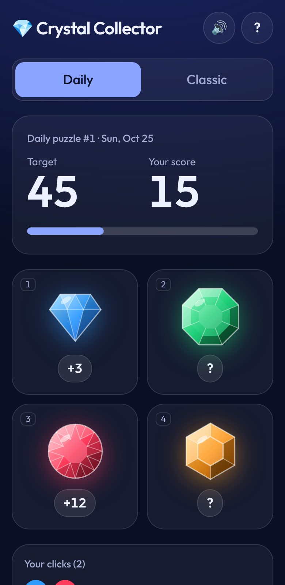
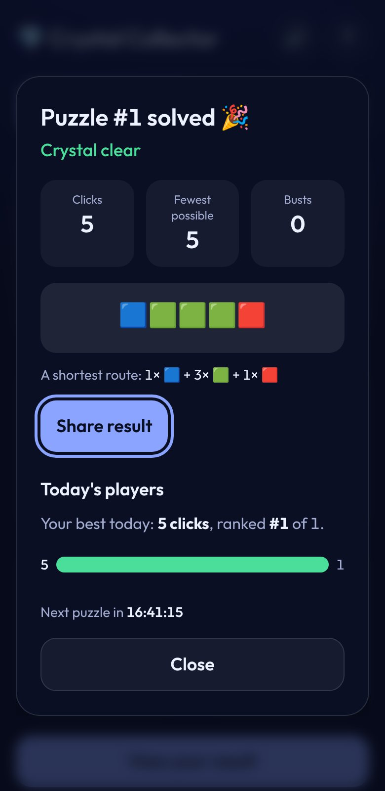
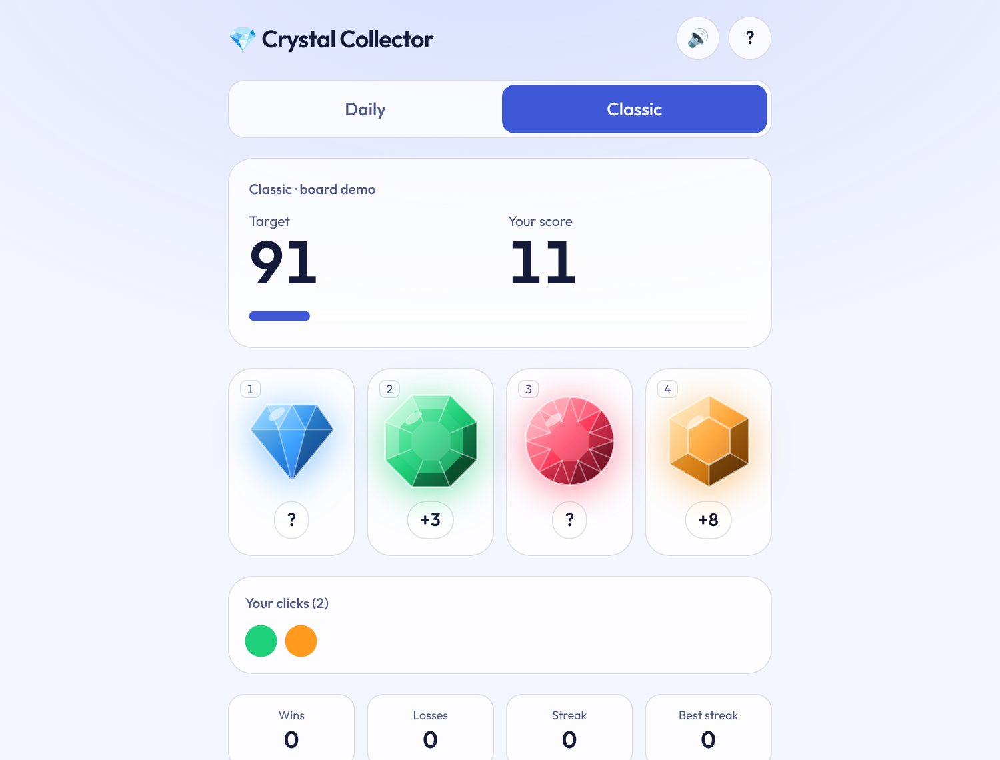
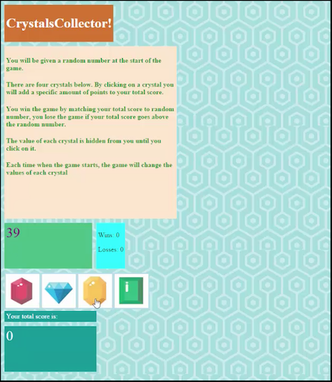
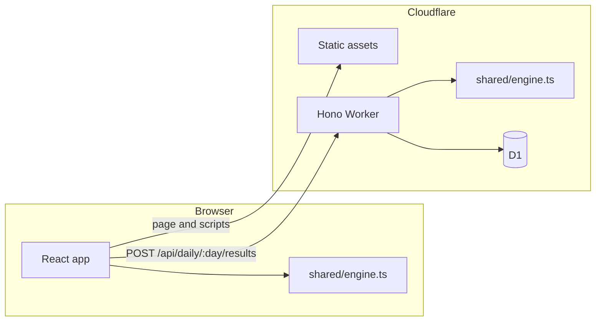

# 💎 Crystal Collector

Hit the target number exactly. Four crystals hide their values until you click them, so every round is part puzzle, part gamble.

- **Daily**: one board for everyone, new at 00:00 UTC. Fewer clicks is better. Share your result as an emoji grid and see where you rank.
- **Classic**: the original game. Endless random rounds with a win/loss tally, and every board has a shareable link.

| Daily board | Result and leaderboard | Classic, light theme |
| --- | --- | --- |
|  |  |  |

> Originally a 2019 jQuery assignment from the University of Toronto SCS Coding Boot Camp, rebuilt in 2026.

<details>
<summary>See the 2019 version</summary>



</details>

**Live demo:** not deployed yet. See [Deploy to Cloudflare](#deploy-to-cloudflare).

## How to play

1. A target number between 19 and 120 is dealt.
2. Click crystals to add to your score. Each is worth 1 to 12, but you only see its value after you click it.
3. Land exactly on the target to win. Go over and you bust: in **Classic** the round is lost, in **Daily** your score resets to zero (every click still counts).
4. Every board can be won, and the result screen shows the shortest route.

Keyboard: `1`–`4` pick a crystal, `?` shows the help.

## What changed since 2019

| | 2019 | Now |
| --- | --- | --- |
| UI | jQuery 3.2.1 from a CDN, `alert()` for results | React 19 + TypeScript, native `<dialog>`, screen-reader announcements |
| Click targets | `` tags | Real buttons, keyboard shortcuts, 44 px touch targets |
| Ranges | Target 19–119 and values 1–11 (the README promised 19–120 and 1–12) | Exactly 19–120 and 1–12, covered by tests |
| Fairness | Roughly 1 board in 18 had no winning route | Every board is winnable, checked with a coin-change solver |
| Variety | One mode | Daily puzzle with shareable result, plus Classic with board links |
| Memory | None | Progress, streaks and tallies saved locally; daily progress survives a reload |
| Backend | None | Cloudflare Worker + D1 leaderboard that re-plays every submitted run |
| Quality | None | Unit, Workers-runtime, end-to-end (desktop, phone, dev mode) and axe accessibility tests in CI |

## How it works



- **One rules engine, two runtimes.** [`shared/engine.ts`](shared/engine.ts) is plain TypeScript with no DOM or Workers APIs. The browser plays rounds with it and the Worker re-plays submitted runs with the same code, so a leaderboard entry can't claim a win that the rules don't allow.
- **Boards are solvable by construction.** Finding the fewest clicks that reach a target is the classic *coin change* problem; a small dynamic-programming solver checks every generated board and the result screen uses it to show a shortest route. About 1.7% of random boards (for example target 19 with four 12s) have no solution and are rejected, as are boards needing more than 12 clicks.
- **Deterministic daily puzzle.** The board comes from a seeded PRNG (mulberry32) keyed by the UTC date, so everyone gets the same one with no server round trip. Known days are pinned in tests so a refactor can never change a past puzzle.
- **Verified leaderboard.** The Worker accepts a list of clicks, replays it on that day's board, and stores only runs that end in a win. Each player keeps their best run; ranks come from a histogram query.

## Run it locally

Requirements: Node 22.12 or newer (`.nvmrc` pins 24) and pnpm 11 via Corepack.

```sh
corepack enable
pnpm install
pnpm exec playwright install chromium   # only needed for the E2E tests
pnpm dev                                # http://localhost:5173, API and local D1 included
```

`pnpm dev` and `pnpm preview` apply the D1 migrations to a local database under `.wrangler/` first, so there is nothing to set up.

| Command | What it does |
| --- | --- |
| `pnpm dev` | Dev server with hot reload; the Worker runs in workerd, as on Cloudflare |
| `pnpm build` | Type-check, then production build (client and Worker) |
| `pnpm preview` | Serve the production build locally |
| `pnpm test` | Unit tests, plus Worker tests inside the real Workers runtime with a local D1 |
| `pnpm e2e` | Playwright against the production build (desktop and phone), accessibility scans, and a dev-mode run that fails on React warnings |
| `pnpm lint` / `pnpm format` | Biome check / fix |
| `pnpm typecheck` | TypeScript for the app, the Worker and the tooling |
| `pnpm knip` | Finds unused files, exports and dependencies |
| `pnpm validate` | Everything above, in order |
| `pnpm cf-typegen` | Regenerates `worker-configuration.d.ts` after editing `wrangler.jsonc` |

## Project layout

```text
shared/        rules engine and API types, imported by both the browser and the Worker
src/           React app: components/ (gem art, dialogs), game/ (reducer, storage), lib/ (API client, sound, share)
worker/        Hono API on Cloudflare Workers, backed by D1
migrations/    D1 schema
e2e/           Playwright specs (gameplay, accessibility, API, dev-mode warnings)
public/        favicon, robots.txt, and _headers (CSP and caching for static assets)
```

## API

| Method and path | Purpose |
| --- | --- |
| `GET /api/health` | Liveness check: `{ "ok": true }` |
| `GET /api/daily/:day/stats?player=<uuid>` | Players, a histogram of clicks, and the caller's rank. Cached for 30 s |
| `POST /api/daily/:day/results` | Body `{ "playerId": "<uuid>", "moves": [0, 2, …] }`. `201` for a new best, `200` if an earlier result was kept |

`:day` is `YYYY-MM-DD` in UTC and must be within one day of today. Errors are JSON, for example `{ "error": "invalid_run", "reason": "unfinished" }`: `invalid_day`, `invalid_player`, `invalid_body`, `unsupported_media_type` (415), `payload_too_large` (413), `day_out_of_range` (422), `invalid_run` (422), `method_not_allowed` (405), `not_found` (404).

Privacy: a result stores a random per-browser UUID, the click and bust counts, and a timestamp. No names, accounts or IP addresses are stored by the app.

## Deploy to Cloudflare

The app deploys as a single Worker with static assets and a D1 database, all declared in [`wrangler.jsonc`](wrangler.jsonc). Pick **one** way to deploy to production (2b or 2c), not both.

### 1. Create the database once

```sh
pnpm exec wrangler login                        # or export CLOUDFLARE_API_TOKEN (needs "D1: Edit")
pnpm exec wrangler d1 create crystal-collector  # prints a database_id
```

Put the printed `database_id` in `d1_databases` in `wrangler.jsonc` and commit it. An explicit id works with every kind of API token. (Wrangler can also create the database during the first deploy, but only if the token is allowed to edit D1.)

### 2a. Deploy from your machine

```sh
pnpm run cf:deploy          # build and upload the Worker and assets
pnpm run db:migrate:remote  # create the table (run again after adding a migration)
```

### 2b. Deploy from GitHub Actions

Add `CLOUDFLARE_API_TOKEN` (template "Edit Cloudflare Workers" plus "D1: Edit") and `CLOUDFLARE_ACCOUNT_ID` as repository secrets. [`ci.yml`](.github/workflows/ci.yml) then deploys and migrates on every push to the default branch after the checks pass, and does nothing while the secrets are missing.

### 2c. Deploy with Cloudflare Workers Builds

If the Worker is connected to this repository in the Cloudflare dashboard, set **Settings → Build** to:

| Setting | Value |
| --- | --- |
| Git branch | the default branch of this repository (`master` unless you rename it) |
| Build command | `pnpm build` |
| Deploy command | `pnpm exec wrangler deploy` |
| Non-production branches | `pnpm exec wrangler versions upload` |

If the build command is empty, as it would be for a plain static site, the deploy fails: the Worker needs the Vite build first. The API token that Workers Builds creates by itself can edit Workers, KV and R2 but **not D1**, which is why step 1 comes first. Apply migrations from your machine with `pnpm run db:migrate:remote`.

The Worker's name is `crystal-collector`; if your Cloudflare project uses another name, change `name` in `wrangler.jsonc` (Workers Builds requires them to match).

## Version notes

Dependencies were current when this was written. A few choices are deliberate:

- **TypeScript 7 with Biome** instead of ESLint: `typescript-eslint` doesn't support TypeScript 6.1 and later yet.
- **pnpm 11, not 12**: pnpm 12 can't be launched through Corepack 0.34 yet, which would break `corepack enable` for everyone.
- **`@types/node` stays on 22**, the oldest Node this project supports, so code can't use APIs the minimum runtime lacks.
- **`overrides` for `undici` and `zod`** in `pnpm-workspace.yaml`: Cloudflare's local-dev packages pin releases with published advisories (dev tooling only, never shipped). Remove the overrides once upstream catches up.
- **`@cloudflare/vitest-plugin`** is the renamed `@cloudflare/vitest-pool-workers`, which is deprecated.
- The Worker tests run with Node.js compatibility flags enabled by the test plugin; the E2E suite exercises the production build *without* them, which is what Cloudflare runs.

[Dependabot](.github/dependabot.yml) opens grouped weekly updates, and CI also runs weekly so drift shows up on its own.

## Ideas to extend

These are not built; they are good next exercises because the pieces already exist.

- **MCP server**: wrap `shared/engine.ts` and the API as tools (`get_daily_puzzle`, `click_crystal`, `solve`) using the Cloudflare Agents SDK, then let an LLM agent play.
- **Agent evaluation**: the hidden values make this an explore-versus-exploit problem. Score policies by clicks over `minClicks` across a few hundred seeded boards and track runs in LangSmith.
- **n8n**: a daily workflow that calls `/api/daily/:day/stats` and posts "Puzzle #N: 128 players, most solved in 8 clicks" to Slack or Discord.
- **PWA**: add a manifest and service worker; the daily board is computed locally, so it could be playable offline.

## Credits

© 2019–2026 Paul Xu. Built at the University of Toronto School of Continuing Studies Coding Boot Camp (2019) and rebuilt in 2026.
